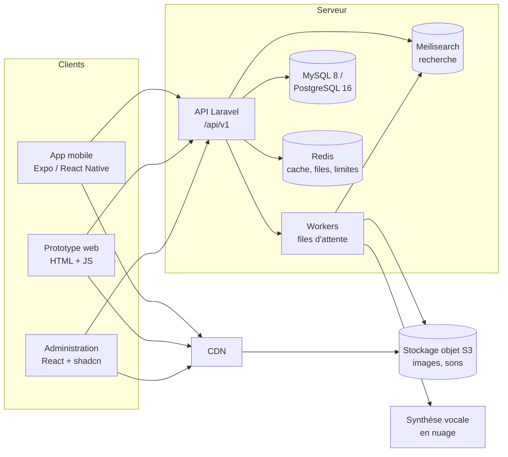

# TRD — Document des exigences techniques

> Imagier parlant · version 1.0 · 8 novembre 2026

## 1. Architecture générale



Principe : l'API ne sert **jamais** les fichiers lourds. Images et sons sont sur un stockage
objet derrière un CDN ; l'API ne renvoie que leurs adresses.

## 2. Choix techniques

| Brique | Technologie | Pourquoi |
|---|---|---|
| API | Laravel 13, PHP 8.4, Sanctum | Déjà en place, API REST complète, jetons simples |
| Base de données | SQLite en dev → **MySQL 8 ou PostgreSQL 16** en production | 50 000 objets × langues, accès concurrents, sauvegardes |
| Cache, files, limites de débit | Redis 7 | Files Laravel (Horizon), cache des séries et du catalogue |
| Recherche | Laravel Scout + Meilisearch | Recherche instantanée et tolérante aux fautes sur 50 000 objets |
| Fichiers | S3 compatible (AWS S3, Cloudflare R2, Scaleway) + CDN | Coût, débit, cache près des utilisateurs |
| Traitement d'image | Intervention Image (libvips) dans un worker | Miniatures et WebP/AVIF générés à l'import |
| Synthèse vocale | Service neuronal en nuage (Google, Azure ou ElevenLabs) appelé par lots | Sons de qualité, stockés une fois pour toutes |
| Voix sur l'appareil (en attendant les sons générés) | `expo-speech` / `speechSynthesis` ; la voix la plus naturelle installée est choisie par `src/lib/voices.ts` (premium/améliorée d'abord, voix fantaisie écartées), le parent peut en choisir une autre | Meilleure voix sans coût ni réseau |
| Administration | Vite 6, React 19, TypeScript, Tailwind 4, shadcn/ui, TanStack Query & Table | Déjà en place |
| Mobile | Expo SDK 58, React Native 0.88, Reanimated 4, expo-audio, expo-speech | Déjà en place, une base pour iOS et Android |
| Reconnaissance vocale mobile | `expo-speech-recognition` (reconnaissance native iOS/Android, sur l'appareil si disponible) | Pas d'envoi de la voix au serveur |
| Reconnaissance vocale web | Web Speech API | Prototype uniquement |
| Stockage local mobile | Fichiers (`expo-file-system`) pour les packs hors connexion, AsyncStorage pour l'index, SecureStore pour le jeton | Hors connexion, sécurité |
| Builds mobiles | EAS Build + EAS Update | Builds stores et correctifs rapides |
| Suivi des erreurs | Sentry (API, admin, mobile), sans données personnelles | Détecter les plantages |

## 3. Exigences non fonctionnelles

### 3.1 Performance

| Mesure | Cible |
|---|---|
| Temps de réponse API (p95) — catalogue, série | < 150 ms |
| Temps de réponse API (p95) — recherche admin | < 100 ms |
| Ouverture de l'app jusqu'à l'accueil | < 2 s sur un téléphone de milieu de gamme |
| Passage d'un objet au suivant | Aucune attente visible (image suivante préchargée) |
| Animations | 60 images/s constantes, sur le fil natif (Reanimated) |
| Taille d'une image servie | ≤ 80 Ko (WebP, 768 px) ; miniature ≤ 10 Ko |
| Taille d'un son | ≤ 40 Ko (AAC/Opus mono, 64 kbit/s) |
| Taille de l'app installée | < 40 Mo hors catalogue téléchargé |

### 3.2 Volume

- 50 000 objets, 1 000 à 2 000 catégories et sous-catégories.
- 2 langues au départ, jusqu'à 10 prévues : jusqu'à 500 000 traductions et autant de sons.
- Environ 4 Go d'images et 20 Go de sons pour 10 langues : à garder sur S3, jamais dans Git.
- Comptes : prévoir 100 000 comptes parents et 300 000 profils sans changer d'architecture.

### 3.3 Disponibilité et reprise

- Disponibilité visée 99,5 %.
- Sauvegarde de la base toutes les nuits, gardée 30 jours ; test de restauration tous les mois.
- Le stockage objet est versionné (un fichier supprimé par erreur se récupère pendant 30 jours).
- L'app mobile doit **continuer à jouer** les catégories téléchargées si l'API est indisponible.

### 3.4 Compatibilité

- iOS 16 et plus, Android 9 (API 28) et plus, téléphones et tablettes, portrait et paysage sur tablette.
- Administration : deux dernières versions de Chrome, Firefox, Safari, Edge.
- Prototype : Chrome et Safari récents (reconnaissance vocale), les autres sans micro.

### 3.5 Accessibilité

- Contraste AA minimum, zones tactiles ≥ 64 pt pour l'enfant, ≥ 44 pt pour le parent.
- Lecteurs d'écran (VoiceOver, TalkBack) sur les écrans parents.
- Option « réduire les animations » respectée.

## 4. Reconnaissance de la réponse

### 4.1 Déroulement technique

1. À l'affichage de la question, l'app demande la permission micro (une seule fois, après
   explication au parent derrière le portail parental).
2. Elle démarre la reconnaissance dans la langue de la partie, avec `contextualStrings` /
   indices contenant le nom et ses variantes (améliore beaucoup la précision).
3. Elle écoute pendant le compte à rebours et s'arrête dès qu'un résultat correspond.
4. Les résultats partiels sont comparés au fil de l'eau ; le premier qui correspond valide.

### 4.2 Comparaison

```
normaliser(texte) =
  minuscules
  → retirer accents et ponctuation
  → retirer articles et déterminants (le, la, les, l', un, une, des, du, the, a, an)
  → retirer « c'est », « it's », « is it »
  → espaces simplifiés
```

Une réponse est juste si, pour au moins une forme acceptée (nom + variantes) et un morceau
de la phrase dite (un ou plusieurs mots collés, pour « c'est une belle pomme » ou « arc en ciel ») :

- égalité après normalisation (seul cas accepté en tolérance **stricte**), **ou**
- même code phonétique (règles simplifiées pour le français et l'anglais, inspirées de
  Phonex et Metaphone), **ou**
- une lettre d'écart au plus, **ou**
- jusqu'au seuil de distance de Levenshtein, si les codes phonétiques ne diffèrent que d'un
  signe (deux en indulgente). Seuil : 0 jusqu'à 3 lettres, 1 jusqu'à 5, 2 au-delà ; +1 en indulgente.

Les deux derniers cas (à peu près) ne valent que pour **toute** la phrase dite : un morceau
d'une phrase plus longue doit être exact ou se prononcer pareil. Sinon « t-shirt » serait
accepté pour « short », « bus stop » pour « shop » ou « papier toilette » pour « panier » ;
ces réponses donnent « presque ».

Une première lettre différente ajoute 2 points (« gâteau » n'est pas « bateau »), sauf si
l'enfant a avalé le début (« apin ») ou fait une substitution courante (« zirafe », « sien »).
Une réponse proche mais refusée renvoie « presque » : l'app affiche « Presque ! » et continue
d'écouter ; elle compte comme fausse si rien de juste n'arrive avant la fin.

La fonction de comparaison est **la même** sur mobile (`mobile/src/lib/answerMatcher.ts`), dans
le prototype (copie générée) et dans l'API (`App\Services\AnswerMatcher`) ; les trois passent les
mêmes cas (`shared/answer-cases.json`) dans l'intégration continue. Pour changer une règle :
ajouter le cas, modifier le TypeScript et le PHP, puis `npm run sync:prototype`.

### 4.3 Repli

- Pas de permission micro, appareil sans reconnaissance, ou langue non prise en charge :
  le mode parent ✓/✗ s'active automatiquement, avec un message pour l'adulte.
- Expo Go ne contient pas le module de reconnaissance : il faut un build de développement
  (`npx expo run:ios`, `npx expo run:android` ou EAS) pour essayer le micro sur un téléphone.
- Aucune donnée audio n'est écrite sur le disque ni envoyée au serveur. Seul le résultat
  (juste / pas juste / sans réponse) est enregistré dans les progrès.

## 5. Hors connexion

- Un « pack » par catégorie (`GET /packs/{slug}`) : les objets dans **toutes** les langues actives,
  avec l'adresse de chaque image (grande + vignette) et de chaque son. Sa version est l'empreinte
  du contenu (12 caractères) : elle change dès qu'un nom, une variante, une image ou un son change.
  `GET /packs` donne la liste, la version et la taille à télécharger. Le pack est construit par
  `PackBuilder` et gardé en cache tant que la catégorie ne change pas.
- Le parent télécharge les catégories dans l'espace parent (« Jouer sans réseau »).
  Téléphone : dossier Documents de l'app, `packs/{slug}-{version}/` (fichiers + `pack.json`).
  Web : Cache Storage du navigateur, lu en adresses `blob:`. L'index (version, taille, fichiers)
  est dans AsyncStorage.
- Mise à jour sans risque : la nouvelle version est téléchargée à côté, puis on bascule et on
  efface l'ancienne. Un échec laisse la version installée intacte. Quelques fichiers manquants
  sur le serveur (moins de 10 %) n'empêchent pas l'installation : l'app garde l'émoji ou la voix
  du téléphone.
- Sans réseau, l'accueil ne propose que les catégories téléchargées et l'app compose la série
  elle-même (même règle que `SeriesBuilder` : jamais deux fois le même objet de suite).
  En ligne, les fichiers déjà téléchargés remplacent ceux du serveur (moins d'attente, moins de données).
- Les résultats de jeu sont mis en file locale et envoyés à la reconnexion
  (idempotence par identifiant unique généré sur le téléphone).
- Plus tard (phase 5) : packs construits par un worker et servis par le CDN, objets « à revoir »
  hors connexion.

## 6. Environnements

| Environnement | Rôle | Données |
|---|---|---|
| Local | Développement | Catalogue de départ (479 objets), SQLite ou MySQL Herd |
| Recette (staging) | Tests avant mise en production, builds de test mobiles | Copie du catalogue, comptes fictifs |
| Production | Utilisateurs réels | Données réelles, accès restreint |

Configuration par variables d'environnement uniquement ; aucun secret dans Git.

## 7. Observabilité

- Journaux structurés JSON côté API, sans e-mail ni prénom en clair.
- Métriques : temps de réponse, erreurs 5xx, longueur des files, échecs de synthèse vocale.
- Alertes : taux d'erreur > 1 % sur 5 minutes, file en retard > 15 minutes, espace disque.
- Mobile : Sentry pour les plantages ; aucune analyse comportementale tierce (règles enfants).
