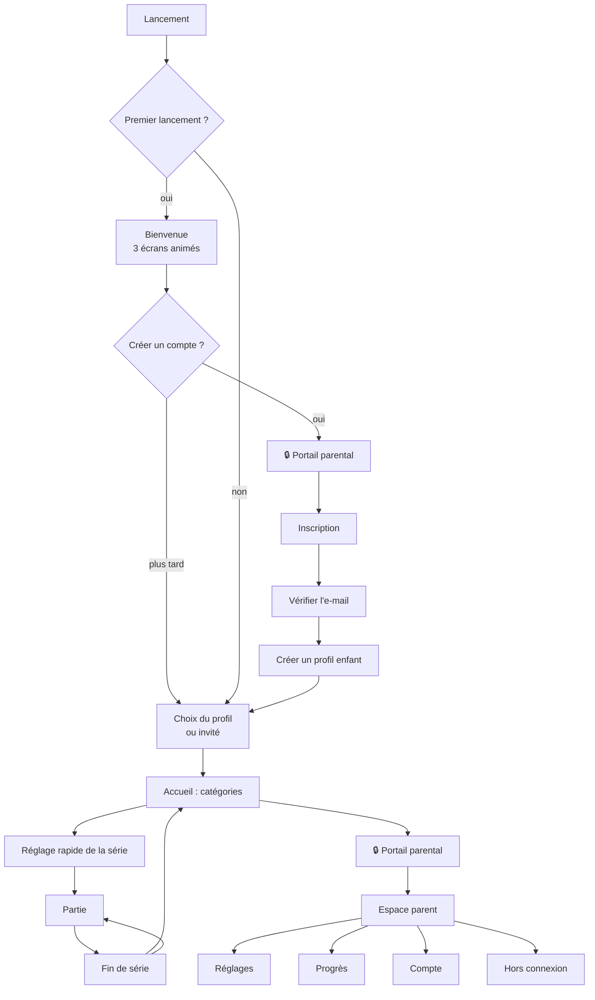
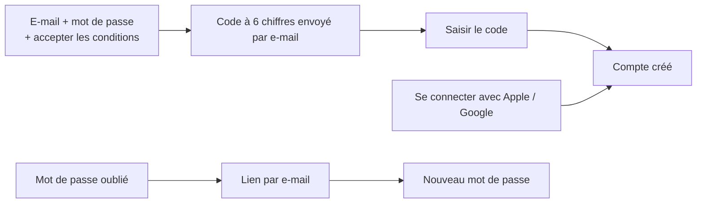
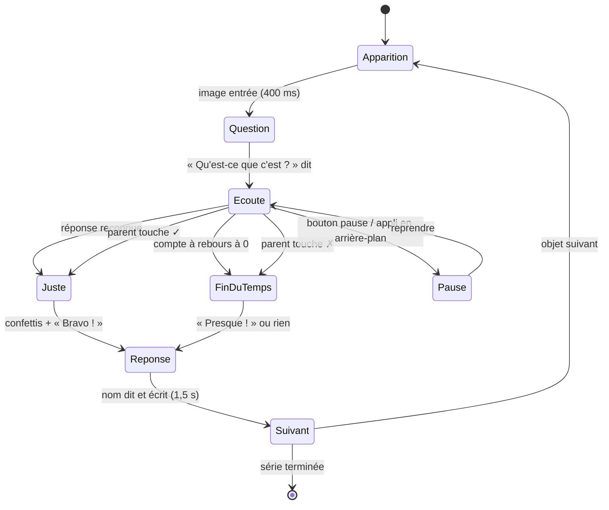
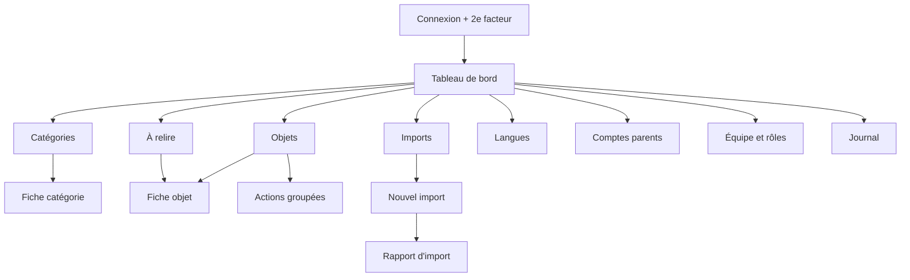

# App flow — Parcours utilisateurs

> Imagier parlant · version 1.0 · 8 novembre 2026

Ce document décrit chaque écran, ce qu'on y fait et où l'on va ensuite.
Les écrans **enfant** se comprennent sans lire ; les écrans **parent** sont derrière le
portail parental (🔒).

## 1. Application mobile — vue d'ensemble



## 2. Écrans de l'application mobile

### 2.1 Bienvenue (premier lancement)

| Écran | Contenu | Action |
|---|---|---|
| 1 | Une image qui s'anime, la voix dit « Qu'est-ce que c'est ? » | Glisser ou « Suivant » |
| 2 | Le compte à rebours tic-tac, puis « C'est une pomme ! » | « Suivant » |
| 3 | Un micro qui sourit : « Réponds à voix haute ! » | « C'est parti » |

Sortie : choix « Créer un compte » (parent) ou « Jouer tout de suite » (invité).

### 2.2 Portail parental 🔒

- Une consigne écrite **et lue** : « Demande à un adulte ».
- Une multiplication simple pour un adulte, impossible pour un petit : « Combien font 4 × 3 ? »
  avec quatre réponses au choix (en place).
- Trois erreurs → retour à l'accueil.
- Protège : inscription, connexion, réglages, compte, liens externes, permission micro.

### 2.3 Inscription et connexion (parent)



- Mot de passe : 10 caractères minimum, vérifié contre les mots de passe compromis connus.
- Si l'appareil a joué en mode invité, les progrès invités sont **rattachés** au premier profil créé.
- Erreurs affichées sous le champ concerné, en phrases simples (« Cet e-mail a déjà un compte. Se connecter ? »).

### 2.4 Profils enfant

- Grille d'avatars (animaux dessinés) ; toucher un avatar = jouer avec ce profil.
- Création : surnom (obligatoire, 20 caractères max), avatar, tranche d'âge (2-3, 4-5, 6-7 ans).
- La tranche d'âge règle la difficulté et le temps du compte à rebours par défaut.
- Jusqu'à 6 profils par compte famille.

### 2.5 Accueil — catégories

- Grandes cartes colorées : image de la catégorie + nom (écrit **et** dit au toucher).
- Haut de l'écran : avatar du profil (toucher = changer de profil), bouton cadenas (espace parent).
- Les catégories téléchargées ont une petite pastille ✓ ; sans réseau, seules elles sont actives.
- Toucher une catégorie → elle se colore et rebondit (sélection multiple possible).
- Une catégorie mère (Animaux) ouvre ses sous-catégories (Ferme, Savane, Mer…) en glissant vers la droite ;
  on peut aussi la jouer entière.
- Gros bouton ▶ « Jouer » qui apparaît dès qu'une catégorie est choisie.

### 2.6 Réglage rapide de la série

Une feuille qui monte du bas, trois choix seulement, avec de grands boutons :

| Réglage | Choix | Par défaut |
|---|---|---|
| Combien d'images ? | 10 · 20 · 50 · 100 | 10 |
| Comment répondre ? | 🎤 À voix haute · 👆 Le parent valide · 👀 Juste regarder | 🎤 si micro autorisé |
| Langue | drapeaux des langues actives | langue du profil |

Les réglages avancés (durée du compte à rebours, traduction, tolérance) sont dans l'espace parent.

### 2.7 Partie — le cœur



**Pas à pas pour un objet :**

1. **Apparition** — la carte glisse et grossit légèrement ; un petit « pop » sonore.
2. **Question** — la voix dit « Qu'est-ce que c'est ? » ; le texte s'affiche en dessous.
3. **Écoute** — l'anneau du compte à rebours se vide avec un tic par seconde ; une icône micro
   pulse doucement quand l'enfant parle (sans afficher ce qui est entendu).
4. **Réponse juste** — l'anneau devient vert, petits confettis, son joyeux, « Bravo ! ».
5. **Réponse fausse ou silence** — pas de son négatif ; « Presque ! » si quelque chose a été dit.
6. **Nom** — la voix dit « C'est une pomme » ; le mot s'écrit lettre par lettre, en gros.
   Option traduction : « 🇬🇧 an apple » en dessous, plus petit.
7. **Suivant** — la carte s'envole, la suivante arrive. Un toucher sur la carte pendant
   l'étape 6 **réécoute** le nom.

**Commandes toujours visibles** (petites, en haut) : ⏸ pause, progression (●●●○○ ou 7/20).
**Mode parent** : deux grands boutons ✓ et ✗ en bas de l'écran pendant l'écoute.

**Pause** : voile flouté, gros bouton ▶ « Reprendre », et en plus petit « Passer cette image »,
« Arrêter la série ». L'app se met en pause seule si elle passe en arrière-plan ou si un appel arrive.

### 2.8 Fin de série

- Animation de récompense (étoiles qui tombent, mascotte qui danse).
- « Tu as trouvé 8 images sur 10 ! » écrit **et** dit ; jamais de « tu as raté ».
- Les objets ratés sont montrés en petites vignettes « À revoir » (toucher = réécouter le nom).
- Trois boutons : 🔁 « Rejouer les mêmes », ▶ « Nouvelle série », 🏠 « Accueil ».

### 2.9 Espace parent 🔒

| Section | Contenu |
|---|---|
| Progrès | Par profil : objets connus, à revoir, catégories préférées, temps de jeu par semaine |
| Réglages de jeu | Durée du compte à rebours, tolérance du micro, traduction, sons, musique, vibrations, réduire les animations |
| Hors connexion | Liste des catégories, taille de chaque pack, télécharger / supprimer, espace utilisé |
| Profils | Ajouter, modifier, supprimer un profil |
| Compte | E-mail, mot de passe, appareils connectés, exporter mes données, **supprimer mon compte** |
| Aide | Questions fréquentes, nous écrire, politique de confidentialité |

## 3. Administration



### 3.1 Écrans

| Écran | Ce qu'on y fait |
|---|---|
| Tableau de bord | Ce qui manque par langue (traductions, sons, images), imports en cours, objets à relire |
| Catégories | Arbre (catégories et sous-catégories) déplaçable à la souris, nom par langue, couleur, image, publication |
| Objets | Tableau paginé côté serveur, recherche instantanée, filtres (catégorie, statut, manque image / son / traduction, difficulté), sélection multiple |
| Fiche objet | Image (déposer, recadrer), nom + variantes acceptées + phrase par langue, son par langue (enregistrer, importer, générer par synthèse, écouter), difficulté, âge, source et licence de l'image, statut |
| Actions groupées | Publier, dépublier, déplacer de catégorie, générer les sons, changer la difficulté, supprimer |
| Nouvel import | 1. Choisir le fichier CSV · 2. Associer les colonnes · 3. Déposer le ZIP des médias · 4. Aperçu des 20 premières lignes et des erreurs · 5. Lancer |
| Rapport d'import | Barre de progression en direct, lignes créées / mises à jour / en erreur, télécharger les erreurs en CSV |
| À relire | File des objets en statut « à relire », raccourcis clavier (A accepter, R refuser, → suivant) |
| Comptes parents | Recherche par e-mail, voir les profils (surnoms seulement), suspendre, supprimer sur demande |
| Équipe | Inviter un membre, choisir son rôle, retirer l'accès |
| Journal | Qui a modifié quoi et quand, filtrable |

### 3.2 Format d'import CSV

```csv
reference;categorie;difficulte;age_min;image;fr_nom;fr_variantes;fr_phrase;fr_son;en_nom;en_variantes;en_phrase;en_son;source_image;licence
pomme-rouge;fruits;1;2;pomme-rouge.webp;une pomme;pomme|la pomme;;;an apple;apple;;;Banque X;CC-BY 4.0
```

- `reference` est la clé unique : réimporter met à jour au lieu de créer un doublon.
- Colonnes `xx_son` vides → son généré par synthèse vocale si l'option est cochée.
- Variantes séparées par `|`.

## 4. Prototype web

Un seul fichier HTML, mêmes étapes que le mobile (accueil → série → partie → fin), sans compte.
Il lit le catalogue depuis l'API quand elle est joignable, sinon sa liste intégrée.
Le micro passe par la Web Speech API quand le navigateur la propose.

## 5. Cas limites à couvrir

| Situation | Comportement attendu |
|---|---|
| Plus de réseau pendant une partie | La série en cours continue (médias préchargés) ; un petit nuage barré apparaît |
| Permission micro refusée | Mode parent proposé, message une seule fois, lien vers les réglages du téléphone (🔒) |
| Catégorie avec moins d'objets que la série | Les objets se répètent, jamais deux fois de suite (déjà en place côté API) |
| Son de l'objet manquant | Voix de synthèse du téléphone |
| Image manquante | Emoji ou illustration de secours |
| Appel téléphonique, notification, verrouillage | Pause automatique |
| Session expirée (parent) | Retour à la connexion en gardant le jeu de l'enfant intact |
| Compte supprimé sur un autre appareil | Déconnexion, retour en mode invité |
