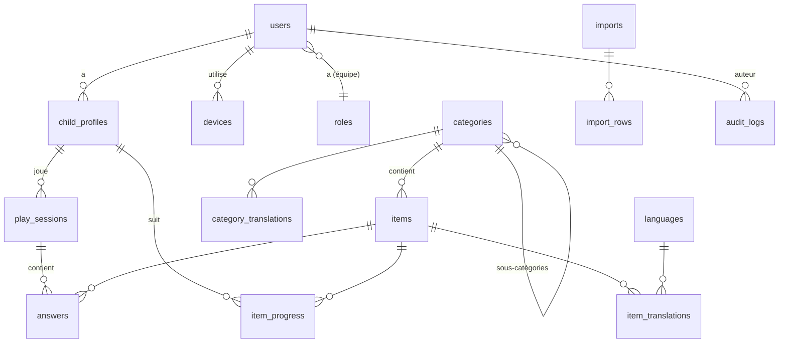

# Backend — API Laravel

> Imagier parlant · version 1.0 · 8 novembre 2026

## 1. Organisation du code

```
api/app/
├── Http/
│   ├── Controllers/Api/V1/          # API publique (app, prototype)
│   │   ├── Auth/                    # inscription, connexion, e-mail, mot de passe   [à faire]
│   │   ├── Me/                      # compte, profils, progrès, appareils            [à faire]
│   │   └── Admin/                   # administration
│   ├── Middleware/                  # SetContentLanguage, EnsureUserIsAdmin, …
│   ├── Requests/                    # validation (Form Requests)
│   └── Resources/                   # forme des réponses JSON
├── Models/                          # Eloquent
├── Services/                        # logique métier (SeriesBuilder, AnswerMatcher, …)
├── Jobs/                            # traitements en file (images, sons, imports, packs)
├── Policies/                        # droits par rôle
└── Events/ Listeners/               # journal, recherche, invalidation du cache
```

Règle : les contrôleurs restent minces (valider → appeler un service → renvoyer une ressource).

## 2. Modèle de données

### 2.1 Schéma



### 2.2 Tables existantes (phase 0)

| Table | Colonnes principales |
|---|---|
| `users` | id, name, email, password, is_admin |
| `languages` | code (unique), name, tts_locale, question, answer_template (`:name`), is_active, sort_order |
| `categories` | slug, emoji, color, image_path, sort_order, is_published |
| `category_translations` | category_id, locale, name — unique (category_id, locale) |
| `items` | category_id, emoji, image_path, sort_order, is_published |
| `item_translations` | item_id, locale, name, sentence, audio_path — unique (item_id, locale) |

### 2.3 Ajouts de la phase 1

| Table | Colonnes |
|---|---|
| `items` | `reference` (unique : « fruits-apple »), `image_variants` (JSON : full, card, thumb) |
| `categories` | `image_variants` |
| `items.emoji`, `categories.emoji` | collation `utf8mb4_bin` sous MySQL (sinon tous les emoji sont égaux) |

### 2.4 Évolutions prévues

**Catalogue (échelle 50 000)**

| Table | Ajouts |
|---|---|
| `categories` | `parent_id` (nullable, index), `depth`, `items_count` (compteur dénormalisé) |
| `items` | ~~`reference`~~ (fait), `status` (draft, review, published, archived), `difficulty` (1-3), `age_min`, `image_source`, `image_license`, `image_variants` (JSON : thumb, card, full), `updated_by` |
| `item_translations` | `aliases` (JSON : variantes acceptées), `audio_source` (recorded, tts, none), `audio_duration_ms`, `phonetic_key` (index, pour la comparaison) |
| `languages` | `stt_locale` (reconnaissance vocale), `tts_voice` (voix de synthèse choisie) |

Index : `items(category_id, status, sort_order)`, `item_translations(locale, name)`,
`items(status, updated_at)`. Les filtres « sans image / sans son / sans traduction » utilisent
des colonnes calculées et indexées (`has_image`, `missing_audio_count`) mises à jour par
événement, pour ne jamais parcourir 500 000 lignes à la volée.

**Comptes et jeu**

| Table | Colonnes |
|---|---|
| `users` | + `locale`, `terms_accepted_at` ✅ ; à venir : `role` (parent, editor, reviewer, admin), `two_factor_secret` (chiffré) |
| `account_codes` ✅ | user_id, purpose (verify, reset), code_hash, attempts, expires_at |
| `social_accounts` | user_id, provider (apple, google), provider_id (unique par provider) |
| `child_profiles` | id (UUID), user_id, nickname (20 car.), avatar, age_band (2-3, 4-5, 6-7), locale, settings (JSON) |
| `devices` | user_id, name, platform, last_seen_at, token_id (jeton Sanctum) |
| `play_sessions` | id (UUID créé sur le téléphone), child_profile_id, locale, categories (JSON), count, mode (voice, parent, watch), started_at, ended_at |
| `answers` | play_session_id, item_id, result (correct, wrong, silent, skipped), response_ms — **jamais l'audio ni le texte entendu** |
| `item_progress` | child_profile_id, item_id, box (1-5, répétition espacée), correct_count, wrong_count, next_due_at — unique (profil, objet) |
| `imports` | user_id, status, file_path, media_path, totals (JSON), started_at, finished_at |
| `import_rows` | import_id, line, reference, status, errors (JSON) |
| `audit_logs` | user_id, action, subject_type, subject_id, changes (JSON), ip (tronquée), created_at |

## 3. API — `/api/v1`

Format : JSON, dates ISO 8601 UTC, langue par `?lang=` ou `Accept-Language`, en-tête
`Content-Language` en retour. Listes paginées par curseur (`?cursor=`) côté app, par page côté admin.

### 3.1 Public (sans compte)

| Méthode | Route | Rôle | État |
|---|---|---|---|
| GET | `/languages` | Langues actives | ✅ |
| GET | `/categories` | Catégories publiées (racines), `?parent=slug` pour les sous-catégories | ✅ (sans arbre) |
| GET | `/categories/{slug}` | Une catégorie et ses objets | ✅ |
| GET | `/series` | `categories`, `count` (1-100), `lang`, `translation`, `difficulty`, `profile` (si connecté : favorise les objets à revoir) | ✅ (sans difficulté ni profil) |
| GET | `/packs` | Liste des packs hors connexion (catégorie, version, taille, URL CDN) | à faire |

Chaque objet renvoyé contient : `id`, `image_url` (+ `thumb_url`), `name`, `sentence`,
`aliases`, `audio_url`, `category`, et `translation` si demandé.

### 3.2 Comptes parents — `/account` ✅

| Méthode | Route | Rôle |
|---|---|---|
| POST | `/account/register` | E-mail, mot de passe (10 car. min, fuites refusées en production), `accept_terms` → envoie un code |
| POST | `/account/verify` | E-mail + code à 6 chiffres + `device_name` → active le compte, renvoie le jeton |
| POST | `/account/verify/resend` | Renvoie un code (réponse identique que l'adresse existe ou non) |
| POST | `/account/login` | E-mail + mot de passe + `device_name` → jeton ; 403 `email_not_verified` + nouveau code si non confirmé |
| POST | `/account/password/forgot` | Envoie un code (réponse identique que l'adresse existe ou non) |
| POST | `/account/password/reset` | Code + nouveau mot de passe → révoque tous les jetons, en renvoie un neuf |
| POST | `/account/logout` | Révoque le jeton courant |

Codes : valables 15 min, 5 essais, gardés hachés (`account_codes`). Jetons Sanctum : capacité `account`, expiration 90 jours.
La connexion de l'administration reste sur `/auth/login` (administrateurs uniquement).
Connexion Apple / Google : à faire (clés des fournisseurs nécessaires).

### 3.3 Espace connecté `/me` (`auth:sanctum`) ✅

| Méthode | Route | Rôle |
|---|---|---|
| GET / PATCH / DELETE | `/me` | Compte (langue, mot de passe avec l'actuel) ; DELETE demande le mot de passe et supprime **tout de suite et définitivement** |
| GET | `/me/export` | Export de toutes les données (JSON) |
| GET / DELETE | `/me/devices`, `/me/devices/{id}` | Appareils connectés, déconnexion à distance |
| GET / POST / PATCH / DELETE | `/me/profiles`, `/me/profiles/{id}` | Profils enfant (6 maximum) ; un profil d'un autre compte répond 404 |
| POST | `/me/profiles/{id}/sessions` | Envoi d'une série jouée (UUID créé sur le téléphone, renvoi sans doublon) |
| GET | `/me/profiles/{id}/progress` | Vus, connus (boîte ≥ 4), en cours, semaine, par catégorie, objets à revoir |

`GET /series?profile={id}` (avec le jeton du parent) glisse jusqu'à 30 % d'objets « à revoir » dans la série.

### 3.4 Administration (`auth:sanctum` + rôle)

Existant : `stats`, `languages`, `categories` (+ `reorder`, `image`), `items` (+ `image`,
`audio/{locale}`). À ajouter :

| Méthode | Route | Rôle | Rôle minimum |
|---|---|---|---|
| POST | `/admin/items/bulk` | Action groupée : publish, unpublish, move, difficulty, generate_audio, delete | éditeur |
| POST | `/admin/items/{id}/audio/{locale}/generate` | Générer le son par synthèse | éditeur |
| POST | `/admin/items/{id}/review` | Accepter / refuser avec commentaire | relecteur |
| GET / POST | `/admin/imports` | Lister, créer (CSV + ZIP, envoi direct sur S3 par URL signée) | éditeur |
| GET | `/admin/imports/{id}` | Progression et erreurs | éditeur |
| GET | `/admin/imports/{id}/errors.csv` | Erreurs téléchargeables | éditeur |
| GET / PATCH / DELETE | `/admin/users` | Comptes parents | admin |
| GET / POST / DELETE | `/admin/team` | Membres de l'équipe et rôles | admin |
| GET | `/admin/audit` | Journal | admin |

### 3.5 Erreurs

| Code | Cas | Corps |
|---|---|---|
| 401 | Jeton absent ou expiré | `{ "message": "Non authentifié." }` |
| 403 | Rôle insuffisant, e-mail non vérifié | `{ "message": "…" }` |
| 404 | Ressource absente ou non publiée | |
| 409 | Conflit métier (supprimer la langue par défaut…) | `{ "message": "…" }` |
| 422 | Validation | `{ "message": "…", "errors": { "champ": ["…"] } }` |
| 429 | Trop de requêtes | en-tête `Retry-After` |

Messages en français par défaut (`lang/fr`), traduits selon `Accept-Language`.

## 4. Services métier

| Service | Rôle |
|---|---|
| `SeriesBuilder` | ✅ Tire une série au hasard, répète si besoin, jamais deux fois le même de suite. À étendre : difficulté, poids des objets « à revoir » (70 % nouveaux / 30 % à revoir) |
| `AnswerMatcher` | Normalisation et comparaison d'une réponse (voir TRD §4.2) — sert aux tests de référence et à vérifier les variantes saisies dans l'admin |
| `SpacedRepetition` | Boîtes de Leitner : juste → boîte suivante ; faux → boîte 1 ; délai 0 / 1 / 3 / 7 / 21 jours |
| `MediaProcessor` | Image d'origine → WebP 768 px, 320 px, 96 px ; suppression des métadonnées EXIF |
| `SpeechSynthesizer` | Appelle le service TTS, normalise le volume, encode en AAC 64 kbit/s, stocke sur S3 |
| `CatalogImporter` | Lit le CSV par blocs de 500 lignes, valide, crée ou met à jour par `reference` |
| `PackBuilder` | Construit le pack hors connexion d'une catégorie quand son contenu change |

## 5. Files d'attente (Redis + Horizon)

| File | Tâches | Concurrence |
|---|---|---|
| `default` | E-mails, journal, recherche | 4 |
| `media` | `ProcessItemImage`, `ProcessItemAudio` | 4 |
| `tts` | `GenerateItemAudio` (limité au quota du fournisseur) | 2 |
| `imports` | `ImportCatalogChunk` (500 lignes par tâche, en lot `Bus::batch`) | 2 |
| `packs` | `BuildCategoryPack` (regroupé : une fois par catégorie toutes les 10 minutes maximum) | 1 |

Chaque tâche est **idempotente** (rejouable sans doublon), avec 3 essais et délai croissant.
Un import de 50 000 lignes doit se terminer en moins d'une heure, médias compris.

## 6. Stockage des fichiers

```
s3://imagier-media/
├── items/{id}/image/{hash}-{taille}.webp        # thumb (96), card (320), full (768)
├── items/{id}/audio/{locale}/{hash}.m4a
├── categories/{id}/{hash}-{taille}.webp
├── packs/{categorie}/{version}.zip
└── imports/{id}/…                               # privé, supprimé après 30 jours
```

- Le nom contient l'empreinte du contenu : un fichier modifié change d'adresse, donc le CDN
  peut garder chaque fichier en cache **un an** (`Cache-Control: public, max-age=31536000, immutable`).
- Les fichiers publics (images, sons, packs) sont lus via le CDN ; les imports sont privés.
- Les envois depuis l'admin passent par des **URL signées** (envoi direct vers S3, l'API ne reçoit
  que la référence) pour ne pas saturer PHP avec des ZIP de plusieurs Go.

## 7. Cache

| Donnée | Clé | Durée | Invalidation |
|---|---|---|---|
| Langues actives | `languages` | 1 h | modification d'une langue |
| Catégories par langue | `categories:{lang}:{parent}` | 1 h | événement sur une catégorie ou un objet |
| Identifiants d'objets publiés par catégorie | `pool:{category}:{difficulty}` | 1 h | événement sur un objet |
| Réponses HTTP publiques | ETag + `Cache-Control: max-age=300` | 5 min | — |

La série est construite à partir des identifiants en cache, puis seuls les objets tirés
sont chargés (avec leurs traductions) : une seule requête de 10 à 100 lignes.

## 8. Recherche

- Laravel Scout avec Meilisearch ; un document par objet : référence, noms et variantes de
  toutes les langues, catégorie, statut, difficulté, manques.
- Mise à jour par file `default` à chaque modification ; réindexation complète par commande
  `php artisan scout:import "App\Models\Item"`.
- En développement sans Meilisearch : moteur `database` (recherche SQL `LIKE`).

## 9. Tests

- Feature tests pour chaque route (cas normal, validation, droits, 404).
- Tests unitaires de `AnswerMatcher` à partir du fichier partagé `shared/answer-cases.json`.
- Test d'import sur un CSV de 1 000 lignes avec erreurs volontaires.
- Test de charge (k6) avant la mise en production : 200 séries/s avec p95 < 150 ms.
- État actuel : 21 tests, tous verts, sur SQLite et MySQL ; Larastan niveau 5 sans erreur.

## 10. Commandes utiles

```bash
php artisan migrate:fresh --seed     # base de démonstration
php artisan test                     # tests
php artisan horizon                  # workers (production)
php artisan queue:work --queue=media,tts,imports,packs,default   # workers (local)
php artisan catalog:packs            # reconstruire tous les packs
php artisan catalog:audio --missing --locale=fr   # générer les sons manquants
```
