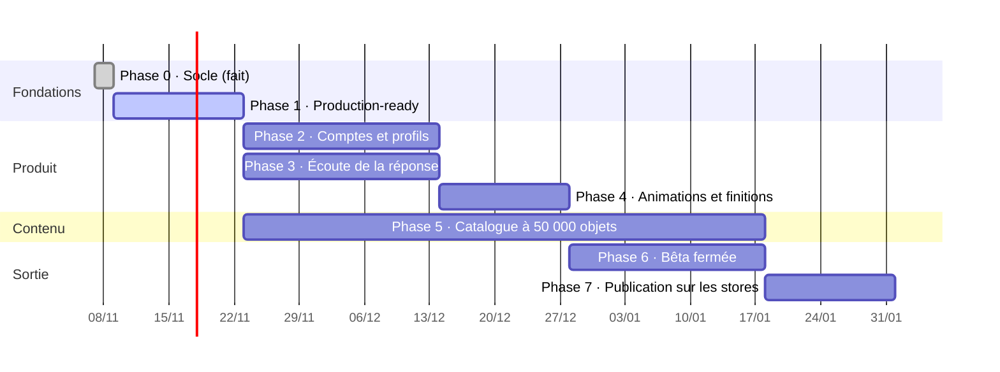

# Plan de réalisation

> Imagier parlant · version 1.0 · 8 novembre 2026

Durées estimées pour une petite équipe (1 à 2 développeurs + 1 personne contenu).
Chaque phase se termine par une démonstration et des critères vérifiables.

## Vue d'ensemble

Les phases 2 et 3 peuvent avancer en parallèle ; la phase 5 (contenu) court pendant tout le
reste, car produire 50 000 objets prend du temps quel que soit le code.

---

## Phase 0 — Socle ✅ (terminée)

- [x] Prototype web jouable (catégories, séries 10-100, compte à rebours, FR/EN)
- [x] API Laravel : langues, catégories, objets, séries, connexion admin — 19 tests verts
- [x] Administration : tableau de bord, catégories, objets, langues, enregistrement de la voix
- [x] Application Expo : accueil, partie, pause, fin
- [x] Catalogue de départ : 11 catégories, 146 objets
- [x] Dépôt GitHub

## Phase 1 — Prêt pour la production (2 semaines)

Rendre le socle solide avant d'ajouter des fonctions.

- [ ] Passer de SQLite à MySQL (Herd en local) ; tests sur MySQL dans l'intégration continue
- [ ] Redis + Horizon ; files `default`, `media`, `tts`, `imports`, `packs`
- [ ] Stockage S3 (disque `s3`) + CDN ; URL de médias avec empreinte ; migration des fichiers existants
- [ ] Traitement des images à l'envoi (WebP 96/320/768, EXIF retiré)
- [ ] Intégration continue GitHub Actions : tests API, lint et build admin, typecheck mobile, audits
- [ ] Environnement de recette (staging) déployé automatiquement depuis `main`
- [ ] Sentry sur les trois applications
- [ ] Traduire en français le README et les messages d'erreur de l'API (`lang/fr`)

**Terminé quand** : une modification fusionnée sur `main` est en recette en moins de 15 minutes,
tests verts, et une image envoyée depuis l'admin s'affiche dans l'app via le CDN.

## Phase 2 — Comptes et profils (3 semaines)

- [ ] API : inscription, code e-mail, connexion, mot de passe oublié, déconnexion (§3.2 backend)
- [ ] API : connexion Apple et Google
- [ ] API : `/me`, profils enfant, appareils, export, suppression avec purge à 30 jours
- [ ] Rôles (`parent`, `editor`, `reviewer`, `admin`) et Policies ; 2FA obligatoire pour l'équipe
- [ ] Mobile : portail parental
- [ ] Mobile : inscription, connexion, profils, avatars ; jeton dans SecureStore
- [ ] Mobile : mode invité conservé, rattachement des progrès invités au premier profil
- [ ] Mobile : envoi des séries jouées (file locale, idempotent) et écran Progrès
- [ ] Répétition espacée dans `SeriesBuilder`
- [ ] Admin : page Comptes parents
- [ ] E-mails en français (vérification, mot de passe, suppression) avec la charte

**Terminé quand** : un parent crée un compte sur un téléphone, ajoute deux profils, joue,
retrouve les progrès sur un second téléphone, puis supprime son compte sans aide.

## Phase 3 — Écouter la réponse et dire si c'est juste (3 semaines)

- [ ] Fichier de référence `shared/answer-cases.json` (300 cas FR + EN : juste, faux, prononciation d'enfant)
- [ ] `AnswerMatcher` en TypeScript (mobile + prototype) et en PHP (API, admin), mêmes tests
- [ ] Champ « variantes acceptées » dans l'admin et l'import ; génération de variantes simples automatique (avec / sans article)
- [ ] Mobile : `expo-speech-recognition`, reconnaissance sur l'appareil, indices de contexte
- [ ] Mobile : états Écoute / Juste / Presque, micro animé selon le volume
- [ ] Mobile : mode parent ✓/✗ et mode « juste regarder »
- [ ] Mobile : demande de permission derrière le portail parental, repli automatique
- [ ] Réglage de tolérance (stricte / normale / indulgente)
- [ ] Prototype web : même fonction avec la Web Speech API
- [ ] Séances de test avec 10 enfants (2-7 ans) ; mesure du taux de faux « c'est faux »

**Terminé quand** : sur les séances de test, ≥ 90 % des bonnes réponses sont reconnues et
≤ 5 % des réponses justes sont refusées ; aucune donnée audio ne sort du téléphone
(vérifié par inspection du trafic réseau).

## Phase 4 — Fluidité, animations, finitions (2 semaines)

- [ ] Reanimated 4 : toutes les animations du catalogue UI/UX §3.2
- [ ] Transition partagée catégorie → partie
- [ ] Préchargement des 3 images et sons suivants ; zéro attente entre deux objets
- [ ] Écran de bienvenue (3 écrans), mascotte, fin de série festive
- [ ] Sous-catégories à l'accueil
- [ ] Mise en page tablette (paysage)
- [ ] « Réduire les animations », tailles de texte, VoiceOver / TalkBack côté parent
- [ ] Mode hors connexion : packs par catégorie, SQLite local, gestion de l'espace
- [ ] Mesures : 60 images/s sur un Android d'entrée de gamme (profilage)

**Terminé quand** : 3 enfants sur 3 lancent une partie seuls, et un parent non prévenu trouve
l'app « fluide » sans relancer d'écran.

## Phase 5 — Catalogue à 50 000 objets (8 semaines, en continu)

Code (2 premières semaines) :

- [ ] Sous-catégories (`parent_id`), arbre déplaçable dans l'admin
- [ ] Colonnes `reference`, `status`, `difficulty`, `age_min`, source et licence d'image
- [ ] Import CSV + ZIP : envoi direct S3, découpage en lots, aperçu, rapport d'erreurs, réimport par `reference`
- [ ] Recherche Meilisearch dans l'admin ; actions groupées
- [ ] Génération des sons par synthèse vocale en lot (`catalog:audio --missing`)
- [ ] Circuit de relecture (brouillon → à relire → publié) et journal des modifications
- [ ] Packs hors connexion reconstruits automatiquement

Contenu (en continu) :

- [ ] Arborescence cible : ~40 catégories, ~800 sous-catégories, validée avant production des images
- [ ] Liste des 50 000 objets (référence, noms FR/EN, catégorie, difficulté), par lots de 2 000
- [ ] Images : source et licence notées pour **chaque** image ; contrôle qualité par échantillon de 5 %
- [ ] Sons : synthèse pour tout, voix humaine pour les 2 000 objets les plus joués
- [ ] Relecture : chaque lot validé par une seconde personne avant publication

**Terminé quand** : 50 000 objets publiés, chacun avec image, nom et son dans chaque langue
active, recherche admin < 100 ms, série API p95 < 150 ms sous charge.

## Phase 6 — Bêta fermée (3 semaines)

- [ ] TestFlight (iOS) et test interne Play Store (Android) via EAS Build
- [ ] 30 à 50 familles, formulaire de retour dans l'espace parent
- [ ] Analyse d'impact (AIPD), registre des traitements, politique de confidentialité
- [ ] Test de charge k6, test de restauration de sauvegarde
- [ ] Revue de sécurité (liste du document sécurité §11)
- [ ] Correction des retours

**Terminé quand** : aucun bug bloquant ouvert, taux de plantage < 0,5 %, retours des familles traités.

## Phase 7 — Publication (2 semaines)

- [ ] Fiches stores en français et en anglais (captures, vidéo, description)
- [ ] Catégorie Enfants (Apple) et programme Familles (Google) : questionnaires remplis
- [ ] Production : API, workers, base, Redis, Meilisearch, S3, CDN, sauvegardes, alertes
- [ ] Admin en production derrière 2FA
- [ ] Prototype web publié comme page de démonstration
- [ ] Soumission aux stores, réponses aux remarques des relecteurs

**Terminé quand** : l'app est téléchargeable sur l'App Store et Google Play.

---

## Ordre des branches

Une branche par lot de travail, une pull request, une revue (voir [08-conventions.md](08-conventions.md)).
Ne jamais démarrer une phase « Produit » avant que la phase 1 ne soit fusionnée.

## Décisions à prendre avant la phase 5

| Décision | Options | Impact |
|---|---|---|
| Source des images | Banques sous licence / prestataire illustrateur / génération + vérification | Coût, style, délai |
| Style visuel des images | Photos réelles / illustrations / mélange | Cohérence, reconnaissance dans la vie réelle |
| Fournisseur de synthèse vocale | Google / Azure / ElevenLabs | Qualité des voix, coût par caractère |
| Langues suivantes | espagnol, arabe, portugais, langues locales… | Volume de sons, reconnaissance vocale disponible |
| Modèle économique | gratuit / abonnement / packs | Règles stores, portail parental pour l'achat |
