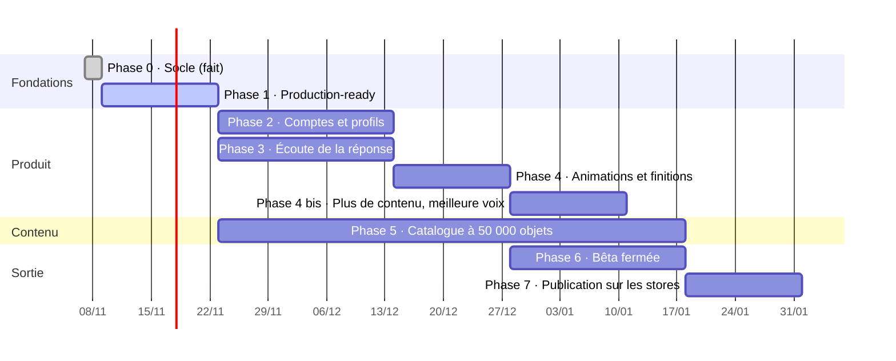

# Plan de réalisation

> Imagier parlant · version 1.0 · 8 novembre 2026

Durées estimées pour une petite équipe (1 à 2 développeurs + 1 personne contenu).
Chaque phase se termine par une démonstration et des critères vérifiables.

## Vue d'ensemble

Les phases 2 et 3 peuvent avancer en parallèle ; la phase 5 (contenu) court pendant tout le
reste, car produire 50 000 objets prend du temps quel que soit le code.

---

## Phase 0 — Socle ✅ (terminée)

- [x] Prototype web jouable (catégories, séries 10-100, compte à rebours, FR/EN)
- [x] API Laravel : langues, catégories, objets, séries, connexion admin — 19 tests verts
- [x] Administration : tableau de bord, catégories, objets, langues, enregistrement de la voix
- [x] Application Expo : accueil, partie, pause, fin
- [x] Catalogue de départ : 11 catégories, 146 objets
- [x] Dépôt GitHub

## Phase 1 — Prêt pour la production (2 semaines) 🚧

Rendre le socle solide avant d'ajouter des fonctions.

- [x] Passer de SQLite à MySQL (Docker en local) ; tests sur SQLite **et** MySQL dans l'intégration continue
- [x] Redis + Horizon ; files `default`, `media`, `tts`, `imports`, `packs`
- [x] Stockage S3 (`MEDIA_DISK=s3`, SeaweedFS en local) ; URL de médias avec empreinte ; commande `media:migrate` pour les fichiers existants
- [x] Traitement des images à l'envoi (WebP 96/320/768, EXIF retiré, faux fichiers refusés)
- [x] Intégration continue GitHub Actions : tests API, Pint, Larastan, lint et build admin, types mobile, audits
- [x] Messages d'erreur de l'API (`lang/fr`) et README en français
- [x] Référence unique par objet (`items.reference`) et comparaison exacte des emoji sous MySQL
- [ ] CDN devant le stockage — **décision : fournisseur** (Cloudflare R2 + CDN, Scaleway, AWS S3 + CloudFront)
- [ ] Environnement de recette (staging) déployé automatiquement depuis `main` — **décision : hébergeur** (Laravel Cloud, Forge + VPS, Ploi…)
- [ ] Sentry sur les trois applications — **à faire : créer le compte et les DSN**

**Terminé quand** : une modification fusionnée sur `main` est en recette en moins de 15 minutes,
tests verts, et une image envoyée depuis l'admin s'affiche dans l'app via le CDN.

## Phase 2 — Comptes et profils (3 semaines) 🚧

- [x] API : inscription, code e-mail, connexion, mot de passe oublié, déconnexion (`/account/*`)
- [ ] API : connexion Apple et Google — **à faire : clés Apple / Google**
- [x] API : `/me`, profils enfant, appareils, export, suppression immédiate et définitive
- [ ] Rôles (`parent`, `editor`, `reviewer`, `admin`) et Policies ; 2FA obligatoire pour l'équipe
- [x] Mobile : portail parental (multiplication, 3 essais)
- [x] Mobile : inscription, connexion, code, mot de passe oublié, profils, avatars ; jeton dans SecureStore
- [x] Mobile : mode invité conservé (rien n'est envoyé sans profil)
- [ ] Mobile : rattachement des progrès invités au premier profil (les invités n'ont pas de progrès enregistrés pour l'instant)
- [x] Mobile : envoi des séries jouées (file locale, renvoi sans doublon) et écran Progrès
- [x] Mobile : mode « Un adulte valide » (✓ / ✗) pour enregistrer des réponses (avance sur la phase 3, R5)
- [x] Répétition espacée (boîtes de Leitner) et objets « à revoir » dans les séries
- [ ] Admin : page Comptes parents
- [x] E-mails en français (code de vérification, code de mot de passe)

**Terminé quand** : un parent crée un compte sur un téléphone, ajoute deux profils, joue,
retrouve les progrès sur un second téléphone, puis supprime son compte sans aide.

## Phase 3 — Écouter la réponse et dire si c'est juste (3 semaines) 🚧

- [x] Fichier de référence `shared/answer-cases.json` (738 cas FR + EN : juste, faux, presque, prononciation d'enfant)
- [x] `AnswerMatcher` en TypeScript (mobile, copié dans le prototype par `npm run sync:prototype`) et en PHP (API), mêmes cas dans l'intégration continue
- [x] Champ « Autres réponses acceptées » dans l'admin (10 au plus) ; nom sans article, pluriel et petites erreurs acceptés sans variante
- [ ] Variantes dans l'import CSV (l'import arrive en phase 5)
- [x] Mobile : `expo-speech-recognition`, reconnaissance sur l'appareil quand c'est possible, indices de contexte (nom et variantes)
- [x] Mobile : états Écoute / Juste / Presque, micro animé selon le volume
- [x] Mobile : mode parent ✓/✗ et mode « juste regarder »
- [x] Mobile : permission demandée dans l'espace parent, repli automatique sur ✓/✗ (Expo Go, refus, langue non prise en charge)
- [x] Réglage de tolérance (stricte / normale / indulgente) dans l'espace parent
- [x] Prototype web : même fonction avec la Web Speech API (réglage « Répondre au micro »)
- [ ] Essai sur de vrais téléphones iOS et Android — **à faire : build de développement** (`npx expo run:ios` / `run:android`, la reconnaissance n'existe pas dans Expo Go)
- [ ] Séances de test avec 10 enfants (2-7 ans) ; mesure du taux de faux « c'est faux » ; ajuster les règles et les cas

**Terminé quand** : sur les séances de test, ≥ 90 % des bonnes réponses sont reconnues et
≤ 5 % des réponses justes sont refusées ; aucune donnée audio ne sort du téléphone
(vérifié par inspection du trafic réseau).

## Phase 4 — Fluidité, animations, finitions (2 semaines) 🚧

- [x] Reanimated 4 dans l'app (accueil, partie, fin) ; plus d'API `Animated` de base dans les écrans
- [x] Partie : entrée de l'image (droite, échelle, rotation), question en fondu, chiffre qui pulse,
  micro selon le volume, 12 confettis et saut de la carte, nom écrit lettre par lettre, sortie vers la gauche
- [x] Partie : anneau qui devient vert (✓) sur une bonne réponse
- [x] Toucher : boutons qui s'enfoncent en ressort (0,94), cartes de catégorie qui rebondissent (1,08)
- [ ] Mascotte (dessin à faire)
- [x] Transition accueil → partie : le bouton « Commencer » grandit jusqu'à remplir l'écran avec les
  catégories choisies, pendant le chargement de la série ; il se replie si la série ne vient pas
- [x] Préchargement des 3 images et sons suivants (`src/preload.ts`)
- [ ] Mesurer l'attente entre deux objets sur un vrai téléphone
- [x] Fin de série festive : étoiles qui tombent, score qui compte, étoile qui danse
- [x] Écran de bienvenue au premier lancement (3 écrans joués : question, compte à rebours et réponse, micro),
  puis « Jouer tout de suite » ou « Créer un compte » (portail parental)
- [ ] Sous-catégories à l'accueil
- [x] Mise en page tablette en paysage pour la partie (image à gauche, réponse à droite)
- [x] Mise en page tablette : accueil en deux colonnes en paysage (catégories | série, sans étapes),
  espace parent en deux colonnes dès 900 px (compte | micro et hors connexion)
- [x] « Réduire les animations » du système respecté (aucune animation de mouvement, pas de confettis)
- [ ] Tailles de texte, VoiceOver / TalkBack côté parent
- [x] Mode hors connexion : packs par catégorie (`/packs`), téléchargement depuis l'espace parent,
  mise à jour et suppression, espace utilisé, partie sans réseau avec les catégories téléchargées
- [ ] Hors connexion : essayer sur un vrai téléphone (avion), objets « à revoir » sans réseau
- [ ] Mesures : 60 images/s sur un Android d'entrée de gamme (profilage)

**Terminé quand** : 3 enfants sur 3 lancent une partie seuls, et un parent non prévenu trouve
l'app « fluide » sans relancer d'écran.

## Phase 4 bis — Plus de contenu et une meilleure voix (2 semaines)

Deux chantiers demandés après la phase 4, avant le grand catalogue de la phase 5.

### A. Une voix plus agréable

Aujourd'hui, l'app lit la question et la réponse avec la voix par défaut du téléphone
(`expo-speech`), un peu plus aiguë (`pitch` 1,1) ; un enregistrement de l'objet passe avant
s'il existe.

Sur le téléphone (rapide, gratuit) :

- [x] Choisir automatiquement la meilleure voix installée pour chaque langue
  (voix « améliorées » ou « premium » d'iOS, voix haute qualité hors ligne d'Android) :
  `src/lib/voices.ts`, recopié dans le prototype
- [x] Espace parent : liste des voix disponibles, bouton « Écouter » pour essayer, choix gardé
  dans les réglages ; explication pour télécharger une voix de meilleure qualité
- [x] Débit et hauteur réglés pour les petits (0,88, ou 0,72 en « Lent » ; hauteur 1,05)
- [x] Prototype web : même choix de la meilleure voix du navigateur
- [ ] Essayer sur iPhone et Android avec une voix premium téléchargée

Sur le serveur (meilleure qualité, la même sur tous les téléphones) :

- [ ] Choisir le fournisseur de synthèse vocale (voir « Décisions à prendre ») : écouter
  une vingtaine de mots d'enfant dans chaque voix candidate, en français et en anglais
- [ ] Commande `catalog:audio --missing` : génère le son de chaque nom et de chaque phrase
  (« C'est une pomme »), volume égalisé, AAC 64 kbit/s, rangé comme les enregistrements actuels
- [ ] Liste de prononciations corrigées (mots mal lus par la synthèse) modifiable dans l'admin
- [ ] Admin : écouter, régénérer ou remplacer par une voix enregistrée, objet par objet
- [ ] Les sons générés partent aussi dans les packs hors connexion (déjà prévu par `PackBuilder`)

**Terminé quand** : chaque objet du catalogue a un son généré dans chaque langue, et
5 parents sur 5 préfèrent la nouvelle voix à l'ancienne à l'écoute à l'aveugle.

### B. Une base plus fournie

Aujourd'hui : 11 catégories, 157 objets, en émojis, français et anglais
(`api/database/seeders/data/catalog.php`, recopié dans le prototype).

- [ ] Passer à ~25 catégories et ~500 objets. Nouvelles catégories possibles : la ferme,
  la mer, les insectes, les oiseaux, le corps, les métiers, les sports, la musique, la météo,
  les formes et couleurs, les émotions, la ville, les outils, les fêtes
- [ ] Compléter les catégories existantes (15 à 25 objets chacune)
- [ ] Pour chaque objet : nom français et anglais avec l'article, phrase quand le modèle
  ne convient pas (pluriels), variantes acceptées au micro (« vélo » / « bicyclette »)
- [ ] Vérifications automatiques : pas de doublon, chaque émoji s'affiche sur iOS et Android,
  chaque nom passe dans le comparateur de réponses (cas ajoutés à `shared/answer-cases.json`)
- [ ] Le seeder ajoute et met à jour sans rien supprimer (déjà le cas) : les progrès des enfants sont gardés
- [ ] Prototype web : même catalogue, généré depuis le fichier de l'API (comme le comparateur)
- [ ] Ensuite, les vraies images (illustrations) remplacent les émojis catégorie par catégorie
  (style à décider, voir « Décisions à prendre »)

**Terminé quand** : 500 objets publiés en français et en anglais, sans doublon ni émoji
manquant, jouables en ligne et hors connexion.

## Phase 5 — Catalogue à 50 000 objets (8 semaines, en continu)

Code (2 premières semaines) :

- [ ] Sous-catégories (`parent_id`), arbre déplaçable dans l'admin
- [ ] Colonnes `reference`, `status`, `difficulty`, `age_min`, source et licence d'image
- [ ] Import CSV + ZIP : envoi direct S3, découpage en lots, aperçu, rapport d'erreurs, réimport par `reference`
- [ ] Recherche Meilisearch dans l'admin ; actions groupées
- [ ] Génération des sons par synthèse vocale en lot (`catalog:audio --missing`)
- [ ] Circuit de relecture (brouillon → à relire → publié) et journal des modifications
- [ ] Packs hors connexion reconstruits automatiquement

Contenu (en continu) :

- [ ] Arborescence cible : ~40 catégories, ~800 sous-catégories, validée avant production des images
- [ ] Liste des 50 000 objets (référence, noms FR/EN, catégorie, difficulté), par lots de 2 000
- [ ] Images : source et licence notées pour **chaque** image ; contrôle qualité par échantillon de 5 %
- [ ] Sons : synthèse pour tout, voix humaine pour les 2 000 objets les plus joués
- [ ] Relecture : chaque lot validé par une seconde personne avant publication

**Terminé quand** : 50 000 objets publiés, chacun avec image, nom et son dans chaque langue
active, recherche admin < 100 ms, série API p95 < 150 ms sous charge.

## Phase 6 — Bêta fermée (3 semaines)

- [ ] TestFlight (iOS) et test interne Play Store (Android) via EAS Build
- [ ] 30 à 50 familles, formulaire de retour dans l'espace parent
- [ ] Analyse d'impact (AIPD), registre des traitements, politique de confidentialité
- [ ] Test de charge k6, test de restauration de sauvegarde
- [ ] Revue de sécurité (liste du document sécurité §11)
- [ ] Correction des retours

**Terminé quand** : aucun bug bloquant ouvert, taux de plantage < 0,5 %, retours des familles traités.

## Phase 7 — Publication (2 semaines)

- [ ] Fiches stores en français et en anglais (captures, vidéo, description)
- [ ] Catégorie Enfants (Apple) et programme Familles (Google) : questionnaires remplis
- [ ] Production : API, workers, base, Redis, Meilisearch, S3, CDN, sauvegardes, alertes
- [ ] Admin en production derrière 2FA
- [ ] Prototype web publié comme page de démonstration
- [ ] Soumission aux stores, réponses aux remarques des relecteurs

**Terminé quand** : l'app est téléchargeable sur l'App Store et Google Play.

---

## Ordre des branches

Une branche par lot de travail, une pull request, une revue (voir [08-conventions.md](08-conventions.md)).
Ne jamais démarrer une phase « Produit » avant que la phase 1 ne soit fusionnée.

## Décisions à prendre avant la phase 5

| Décision | Options | Impact |
|---|---|---|
| Source des images | Banques sous licence / prestataire illustrateur / génération + vérification | Coût, style, délai |
| Style visuel des images | Photos réelles / illustrations / mélange | Cohérence, reconnaissance dans la vie réelle |
| Fournisseur de synthèse vocale | Google / Azure / ElevenLabs | Qualité des voix, coût par caractère |
| Langues suivantes | espagnol, arabe, portugais, langues locales… | Volume de sons, reconnaissance vocale disponible |
| Modèle économique | gratuit / abonnement / packs | Règles stores, portail parental pour l'achat |
